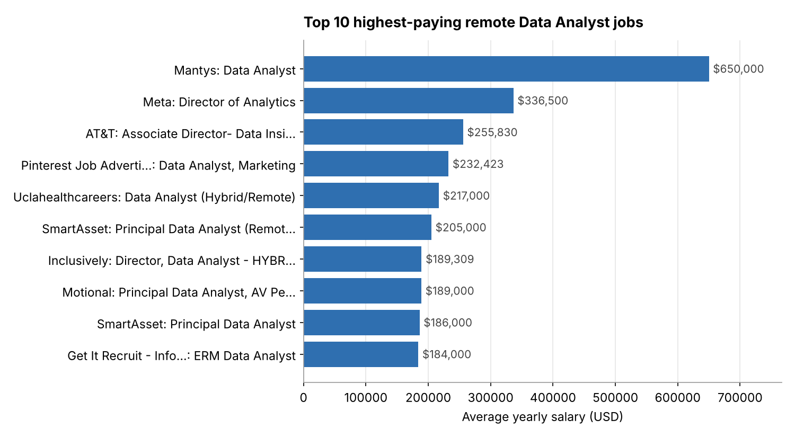
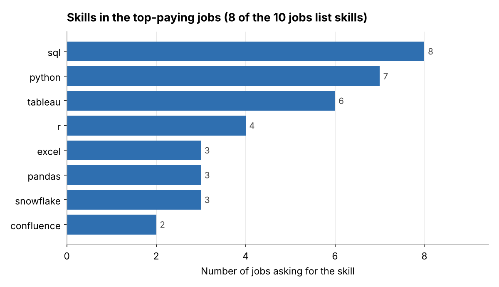
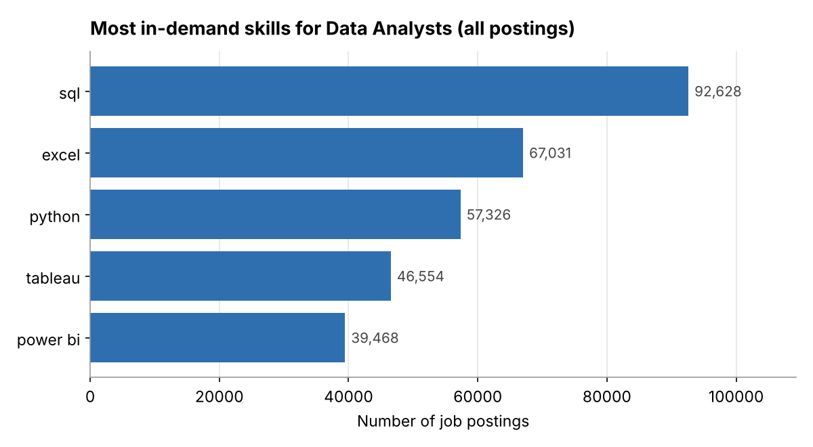
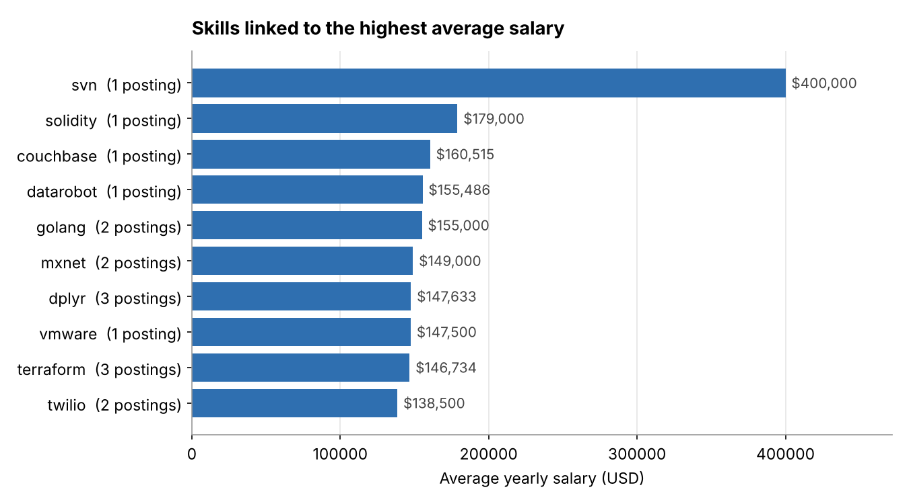
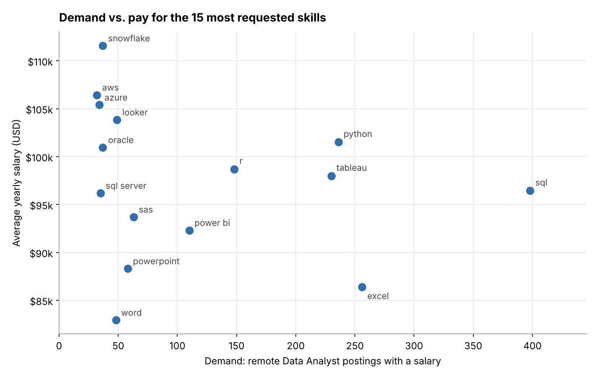

# SQL Data Job Market Analysis

## Introduction

I used SQL to explore real data analyst job postings and answer one question: what does it take to land a well-paid data analyst job? I looked at which jobs pay the most, which skills employers ask for, and which skills are worth learning first.

SQL queries: [project_sql folder](/project_sql)

## Background

The data covers **787,686 job postings** from December 2022 to December 2023, with job titles, locations, companies, salaries and required skills. Only about **2.8%** list a salary, so every pay comparison uses that smaller group.

The questions I wanted to answer:

1. What are the top-paying remote data analyst jobs?
2. What skills do those jobs ask for?
3. Which skills are in the highest demand?
4. Which skills are linked to the highest salaries?
5. Which skills are the best to learn, with both high demand and good pay?

## Tools I Used

- **SQL** for the analysis
- **PostgreSQL** to store the data
- **pgAdmin** to manage the database and load the files
- **Visual Studio Code** (with SQLTools) to write and run queries
- **Git and GitHub** to track and share my work

## The Analysis

Salaries are yearly averages in US dollars.

### 1. Top-paying data analyst jobs

The 10 highest-paying remote Data Analyst jobs that list a salary.

```sql
SELECT
    job_id,
    job_title,
    job_location,
    job_schedule_type,
    salary_year_avg,
    job_posted_date,
    name AS company_name
FROM
    job_postings_fact
LEFT JOIN company_dim ON job_postings_fact.company_id = company_dim.company_id
WHERE
    job_title_short = 'Data Analyst' AND
    job_location = 'Anywhere' AND
    salary_year_avg IS NOT NULL
ORDER BY
    salary_year_avg DESC
LIMIT 10;
```



- Salaries range from **$184,000 to $650,000**. The $650,000 posting (Mantys) is far above the rest, so I treat it as an outlier.
- Most top roles are senior, such as Director or Principal, at companies like Meta, AT&T and Pinterest.

### 2. Skills behind the top-paying jobs

The same 10 jobs, joined to the skills tables.

```sql
WITH top_paying_jobs AS (
    SELECT
        job_postings_fact.job_id,
        job_title,
        salary_year_avg,
        name AS company_name
    FROM
        job_postings_fact
    LEFT JOIN company_dim ON job_postings_fact.company_id = company_dim.company_id
    WHERE
        job_title_short = 'Data Analyst' AND
        job_location = 'Anywhere' AND
        salary_year_avg IS NOT NULL
    ORDER BY
        salary_year_avg DESC
    LIMIT 10
)
SELECT
    top_paying_jobs.*,
    skills_dim.skills AS skill_name
FROM top_paying_jobs
INNER JOIN skills_job_dim ON top_paying_jobs.job_id = skills_job_dim.job_id
INNER JOIN skills_dim ON skills_job_dim.skill_id = skills_dim.skill_id
ORDER BY
    salary_year_avg DESC;
```



- Only 8 of the 10 jobs list skills. The two best-paid list none.
- **SQL** appears in all 8, **Python** in 7 and **Tableau** in 6.

### 3. Most in-demand skills

All Data Analyst postings, not just remote ones.

```sql
SELECT
    skills,
    COUNT(skills_job_dim.job_id) AS demand_count
FROM
    job_postings_fact
INNER JOIN skills_job_dim ON job_postings_fact.job_id = skills_job_dim.job_id
INNER JOIN skills_dim ON skills_job_dim.skill_id = skills_dim.skill_id
WHERE
    job_title_short = 'Data Analyst'
GROUP BY
    skills
ORDER BY
    demand_count DESC
LIMIT 5;
```



- **SQL** leads with 92,628 postings, then **Excel** (67,031), **Python** (57,326), **Tableau** (46,554) and **Power BI** (39,468).

### 4. Skills linked to higher salaries

The average salary for each skill, across all Data Analyst postings that list a salary.

```sql
SELECT
    skills,
    ROUND(AVG(salary_year_avg), 0) AS average_salary
FROM
    job_postings_fact
INNER JOIN skills_job_dim ON job_postings_fact.job_id = skills_job_dim.job_id
INNER JOIN skills_dim ON skills_job_dim.skill_id = skills_dim.skill_id
WHERE
    job_title_short = 'Data Analyst' AND
    salary_year_avg IS NOT NULL
GROUP BY
    skills
ORDER BY
    average_salary DESC
LIMIT 25;
```



- The top of the list is rare skills like **SVN** ($400,000) and **Solidity** ($179,000), each based on only one or two postings, so I take them with caution.
- Skills with more postings behind them, like **Kafka**, **PyTorch**, **TensorFlow**, **Airflow** and **Scala**, still average over $115,000. They are mostly data engineering and machine learning tools.

### 5. The most optimal skills to learn

Demand is counted from remote postings with a salary. The average salary uses all locations.

```sql
WITH skills_demand AS (
    SELECT
        skills_dim.skill_id,
        skills_dim.skills,
        COUNT(skills_job_dim.job_id) AS demand_count
    FROM
        job_postings_fact
    INNER JOIN skills_job_dim ON job_postings_fact.job_id = skills_job_dim.job_id
    INNER JOIN skills_dim ON skills_job_dim.skill_id = skills_dim.skill_id
    WHERE
        job_title_short = 'Data Analyst' AND
        salary_year_avg IS NOT NULL AND
        job_work_from_home = TRUE
    GROUP BY
        skills_dim.skill_id
), average_salaries AS (
    SELECT
        skills_job_dim.skill_id,
        skills_dim.skills,
        ROUND(AVG(salary_year_avg), 0) AS average_salary
    FROM
        job_postings_fact
    INNER JOIN skills_job_dim ON job_postings_fact.job_id = skills_job_dim.job_id
    INNER JOIN skills_dim ON skills_job_dim.skill_id = skills_dim.skill_id
    WHERE
        job_title_short = 'Data Analyst' AND
        salary_year_avg IS NOT NULL
    GROUP BY
        skills_job_dim.skill_id,
        skills_dim.skills
)
SELECT
    skills_demand.skill_id,
    skills_demand.skills,
    demand_count,
    average_salary
FROM
    skills_demand
INNER JOIN average_salaries ON skills_demand.skill_id = average_salaries.skill_id
ORDER BY
    demand_count DESC,
    average_salary DESC
LIMIT 25;
```



| Skill | Remote postings | Average salary |
|---|---|---|
| SQL | 398 | $96,435 |
| Excel | 256 | $86,419 |
| Python | 236 | $101,512 |
| Tableau | 230 | $97,978 |
| R | 148 | $98,708 |
| Power BI | 110 | $92,324 |

- **SQL** has by far the most demand with a solid salary, and **Python** pays best among the common skills.
- **Excel** is widely requested but pays less.
- Cloud tools pay more but are asked for less often: **Snowflake** ($111,578), **AWS** ($106,440) and **Azure** ($105,400).

## What I Learned

- **Joins and aggregations:** I joined up to three tables and used `COUNT`, `AVG` and `GROUP BY`. A join on the wrong column returns no data at all, so I learned to check every `ON` line.
- **CTEs:** Splitting a big question into named steps made my queries easier to read and fix.
- **Missing data:** Most postings have no salary, so I learned to use `IS NOT NULL` and to ask how many postings a result is based on.
- **Messy data:** The skills table lists SAS twice under two IDs. Real data has quirks worth checking for.

## Conclusion

- **The best-paid remote data analyst jobs are senior ones**, paying from $184,000 up to $650,000.
- **SQL is the skill to learn first.** It is the most requested skill and appears in every top-paying job that lists skills.
- **Python, Tableau and Excel round out the core toolkit.** Cloud and data engineering skills pay more but are a second step.

If I were starting from zero, I would learn SQL first, then Excel, Python and Tableau or Power BI, and then one cloud skill.

*This project follows the "SQL for Data Analytics" course by Luke Barousse and uses the course dataset. The analysis and write-up are my own.*
